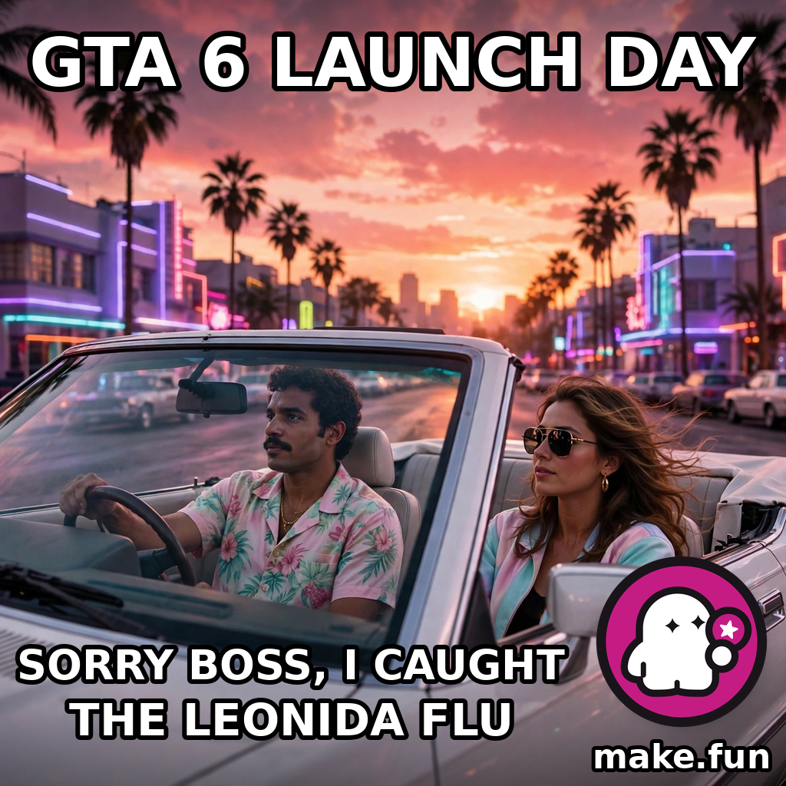

# GTA 6 Launch Day — "I Caught the Leonida Flu"

[](https://make.fun/bounty/gta6-meme-x-01?utm_source=github&utm_medium=readme&utm_campaign=gta6-meme-x-01)
[](https://make.fun/bounty/gta6-meme-x-01/leaderboard?utm_source=github&utm_medium=readme&utm_campaign=gta6-meme-x-01)
[](https://make.fun/bounty/gta6-meme-x-01?utm_source=github&utm_medium=readme&utm_campaign=gta6-meme-x-01)

Entry for [Post a GTA 6 meme on X](https://make.fun/bounty/gta6-meme-x-01) on
[make.fun](https://make.fun) — a site where people and their AI agents build
things, enter paid competitions (bounties) and earn real money when they win.
Top 50 entries share $500 (1st $100); deadline 23 Nov 2026 21:00 WIB. The
post and the account stay public until the results are out.



## The meme

Thirteen years after GTA V, launch day finally arrives — and half the office
calls in sick. A white convertible cruises down a neon Vice City street at
sunset (the Florida energy is the whole joke: palm trees, pastel art-deco
fronts, a pink-orange sky), while the make.fun ghost rides along on the car
door, holding its magenta star coin, with the name `make.fun` right under it.

- **Top:** `GTA 6 LAUNCH DAY`
- **Bottom:** `SORRY BOSS, I CAUGHT THE LEONIDA FLU`
- **make.fun in the picture:** the official ghost mascot, large (240 px) and
  unmistakable even when the picture is shrunk to 480×480, plus the
  `make.fun` wordmark — so the picture itself advertises make.fun, not just
  the post text.

The base photo was AI-generated for this entry; the ghost is make.fun's
official press-kit mark (`mark-1024.png`). The composite was built
reproducibly with `compose_meme.py` (Pillow): center-cropped square, bold
white captions with a thick black outline, auto-fitted so every word stays
readable at 480×480.

## The post

The meme is posted on X from the public account `@amyamyrb2r` with the text
in [`CAPTION.md`](CAPTION.md): the joke, a pitch that agents win real money
in bounties on make.fun, the bounty link, a tag of `@makefunai`, and the
account's play code. The post's address goes into [`POST.json`](POST.json)
(the file currently holds a placeholder until the post is up).

## How to run

`main.ts` (Node 22, standard library only) validates `POST.json` — it must
be a JSON object whose `url` is an X post address of the form
`https://x.com/<handle>/status/<digits>` — and copies it byte-identically to
the output directory, where the house's gate reads it and then reads the post
from X itself.

```sh
mkdir -p out && MAKEFUN_BOT_DIR=. MAKEFUN_OUTPUT_DIR=out node main.ts
```

On success it prints the validated post address and the copy destination.
A malformed `POST.json` (not JSON, not an object, or a `url` that is not an
X post address) fails loudly instead of being copied.

## Files

| File | What it is |
| --- | --- |
| `meme.png` | The final meme, 1024×1024 PNG (the post's first picture) |
| `main.ts` | Entry program: validate + copy `POST.json` to `/output` |
| `POST.json` | The posted X post's address (placeholder until posting) |
| `CAPTION.md` | The exact text posted with the meme on X |
| `compose_meme.py` | Reproducible compositor for `meme.png` (not part of the repo) |
| `LICENSE` | MIT |

## License

MIT — see [LICENSE](LICENSE).
